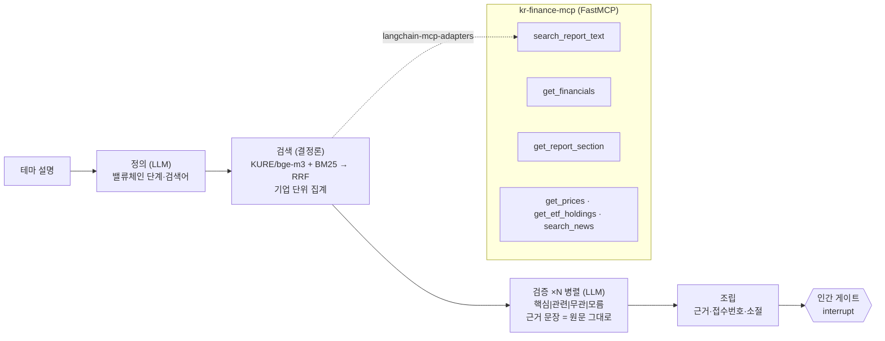

# 근거 (dart-theme-agent)

> 사업보고서 원문에서 **근거 문장**을 찾아 테마 소속 기업을 가려내고, 근거가 약하면 **기권**하며, 실제 테마 ETF 구성종목으로 **채점**되는 LangGraph 에이전트. 밑에는 DART·KRX·뉴스를 LLM용 도구로 묶은 **MCP 서버**가 있고, 그 서버의 설계를 실험으로 정했다.

2026-10-12 하루에 설계·구현·평가(코스피200 × 2개 연도, 테마 5개, 질문 100개). 전체 결과표는 [`results/REPORT.md`](results/REPORT.md), 결과 페이지는 [`results/index.html`](results/index.html).

## 한 문장

테마 소속을 **뉴스가 아니라 공시로 증명**하고, **실제 ETF 구성종목으로 채점**했고, **도구 설계가 에이전트 정확도를 얼마나 바꾸는지** 쟀다.

## 결과 요약 (테마 5개 · 코스피200 · 사업연도 2024·2025 · Gemini 3.5 Flash)

**C-1 테마 복원** — 바스켓을 실제 테마 ETF 구성종목(∩ 코스피200, 정답 8~12개)으로 채점

| 구성 | 정밀도 | 재현율 | 기권률 | 기권 적중 |
|---|---|---|---|---|
| R0 검색만 (상위 15) | 39% | 65% | — | — |
| **R1 정의→검색→검증** (핵심+관련) | 44% | **85%** | 12% | **7/8** |
| R1 에서 **핵심 판정만** | **72%** | 65% | | |
| R2 단일 질의 + 검증 | 75% | 51% | 2% | — |

정밀도가 낮아 보이는 이유는 둘이다. ① '관련' 라벨이 지주사(GS·HD현대·SK)와, 자동차 설명에 '할부금융'을 넣은 탓에 카드·은행을 끌어왔다. ② 2차전지의 SK아이이테크놀로지(분리막)·에코프로머티(전구체)처럼 **실제 밸류체인 기업인데 시가총액 상위 10종목 ETF 에는 없는** 회사가 오답으로 집계된다. 원전에서 못 찾은 3곳(LS ELECTRIC·HD현대일렉트릭·효성중공업)은 전력기기 회사로, 지수는 원전 밸류체인에 넣지만 사업보고서는 원전을 말하지 않는다. 라벨별 전체 목록은 [`results/c1_breakdown.md`](results/c1_breakdown.md).

**C-2 검색 품질** (LLM 없음, 질의 = 테마 설명 1 + 밸류체인 검색어 16~18) — 기업 단위 Recall

| 검색 | Recall@10 | Recall@30 |
|---|---|---|
| BM25 (kiwi 형태소) | **63%** | 82% |
| KURE-v1 dense | 48% | 80% |
| KURE-v1 + BM25 → RRF | 57% | 84% |
| bge-m3 dense | 49% | 80% |
| bge-m3 + BM25 → RRF | 58% | **85%** |

검색어가 "원자로 제작", "조선용 후판" 같은 짧은 명사구라 어휘 매칭이 세고, 하이브리드는 깊은 재현율에서 이긴다.

**C-3 도구 설계 실험** — 같은 DART 데이터, 같은 에이전트(단일 ReAct, 같은 프롬프트), 서버 설계만 다르게. 질문 100개(정답은 DART 재무 API 로 계산)

| 서버 | 정확도 | 입력 토큰/질문 | 출력 토큰 | 도구 호출 | 초 |
|---|---|---|---|---|---|
| 날것: 도구 2개, 영문 키, 원 단위 문자열, 빈 결과는 `[]` | 95/100 | 50,547 | 872 | 2.75 | 7.0 |
| 설계: 도구 분리, 한국어 설명, 억원+단위 필드, 오류에 "다음에 할 일" | **100/100** | **3,741** | 510 | 2.66 | 4.5 |

날것 서버의 실패 5건 중 4건은 "공시되지 않아 확인할 수 없다"며 포기한 것이다 — 빈 결과를 `[]` 로만 돌려주면 에이전트는 '없다'고 결론 내린다. 같은 질문을 다시 돌리면 맞추기도 한다(비결정적). 채점기 결함 2건(음수 복합 표기, "% 감소" 방향)은 실패 검토에서 찾아 고친 뒤 두 서버를 똑같이 재채점했다(고치기 전 97/92).

## 구조



- LLM 호출은 **정의·검증 두 노드뿐**. 검색·조립·채점은 결정론.
- 검증 노드의 근거 문장은 코드가 원문과 글자 단위로 대조한다. 바꿔 쓴 근거는 **모름**으로 내린다.
- 숫자 도구의 출력에는 단위·연결/별도·사업연도·출처가 항상 붙는다. 오류 응답에는 "다음에 할 일"이 있다.

## 평가 (분모까지)

| 평가 | 무엇을 재나 | 정답 |
|---|---|---|
| C-1 테마 복원 | 바스켓의 정밀도·재현율·기권률·기권 적중 | 테마 ETF 5개의 실제 구성종목 ∩ 코스피200 |
| C-2 검색 품질 | 임베딩 2종 × {dense, hybrid} → 기업 단위 Recall@10/30 | 같은 정답, LLM 없음 |
| C-3 도구 설계 | 같은 데이터·같은 에이전트, 서버 설계만 다를 때 정확도·토큰·실패 유형 | DART 재무 API로 계산한 100문항 |

## 재현

```bash
python3.12 -m venv .venv && .venv/bin/pip install -r requirements.txt && .venv/bin/pip install -e .
cp .env.example .env   # OPENDART_API_KEY · KRX_ID/KRX_PW · Gemini(Vertex ADC)
PYTHONPATH=src .venv/bin/python scripts/build_corpus.py        # 사업보고서 수집·파싱
PYTHONPATH=src .venv/bin/python scripts/build_index.py         # 청킹·BM25·임베딩·Chroma
PYTHONPATH=src .venv/bin/python -m dta.eval.run_c2             # 검색 품질
PYTHONPATH=src .venv/bin/python -m dta.eval.run_c1             # 테마 복원
PYTHONPATH=src .venv/bin/python -m dta.eval.questions && PYTHONPATH=src .venv/bin/python -m dta.eval.run_c3   # 도구 설계
PYTHONPATH=src .venv/bin/python -m dta.app.cli theme "원전" --desc "원자력 발전 밸류체인 ..."   # 직접 써 보기
```

MCP 서버를 Claude Code 에 붙이기: `claude mcp add kr-finance -- $PWD/.venv/bin/python -m dta.mcp_server.server`

## 금융 데이터의 함정과 처리 (실측으로 생긴 규칙)

| 함정 | 처리 |
|---|---|
| DART 재무 숫자는 **원 단위 문자열** | 도구 계층에서 억원(`value_eok`)과 원(`value_won`)을 같이 주고 `unit` 필드를 강제(테스트가 막는다) |
| 연결/별도가 섞이면 다른 숫자 | 모든 숫자 도구에 `fs_div`(CFS/OFS) 필수. 지주사·금융사는 연결이 없을 수 있어 오류에 "별도로 다시" 안내 |
| 정정공시: `[첨부정정]` 접수번호에는 **원문 파일이 없고**(DART status 014), `[기재정정]` 접수번호는 **정정신고서만** 담겨 '사업의 내용'이 없을 수 있다 | 사업보고서 후보를 늦은 순으로 받아, 원문이 있고 섹션이 추출되는 첫 접수번호로 폴백. 마지막 실패 사유를 기록 |
| 비거래일에 KRX 는 **빈 결과** | 기준일은 마지막 거래일로 고정(2026-10-08; 10-09 한글날·10-10 토). 빈 유니버스는 명시적 오류 |
| pykrx 는 **KRX 로그인** 없이는 거의 아무것도 못 준다 | `.env` KRX_ID/KRX_PW. 받은 CSV 를 캐시해 재현에는 로그인이 필요 없게 |
| 정답 누설 | 테마 설명에 구성종목이 들어가면 테스트가 막는다. 프롬프트 어디에도 종목 목록이 없다 |
| LLM 이 근거를 **바꿔 쓴다** | 근거 문장을 원문과 공백 무시 글자 단위로 대조. 불일치면 `모름` 으로 내리고 사유를 남긴다 |
| 괄호 되풀이 "3조 3,931억원(33,931억원)" | 채점기가 단위 순서가 깨지면 새 값으로 본다(합산 금지) |

## 한계 (잰 것만 적는다 — 결과표와 함께 갱신)

- 대상이 **코스피200 × 2개 연도**다. 테마 ETF 구성종목 중 코스닥·범위 밖 종목은 분모에서 뺐고 뺀 수를 표에 적었다. 전 상장사로 넓히면 재현율의 상한이 올라가는 대신 후보 잡음도 는다.
- 테마가 **5개**, 테마당 정답이 **8~12개**다. 재현율 한 칸이 8~12%p 다. 평균은 참고치이고 테마별 표를 같이 봐야 한다.
- 정답으로 쓴 ETF 중 "TOP10"류는 **시가총액 상위 종목 위주**라, 사업보고서로 찾은 중소형 관련 기업이 "오답"으로 집계될 수 있다. 정밀도는 그래서 보수적으로 읽어야 한다.
- 검증 노드는 **발췌 3개**만 읽는다. 테마 활동이 보고서의 다른 소절에만 적힌 기업은 '모름'이 된다 — 이것이 기권 지표에 그대로 드러난다.
- 근거 정확도(근거 문장이 소속을 실제로 뒷받침하는 비율)는 **사람이 30개를 읽어야 나오는 값**이다. 표본은 [`results/c1_evidence_sample.md`](results/c1_evidence_sample.md)에 준비돼 있고 **아직 미채점**이다. LLM 심판으로 대신 채우지 않았다.
- LLM 은 Gemini 3.5 Flash 하나다. 모델을 바꾸면 수치가 달라진다(코드는 `dta/llm.py` 한 곳만 바꾸면 된다).

## 안 하는 것

종목·시점 추천, 목표가, 수익률 예측. 이 도구는 지수 설계 보조이며 투자 조언이 아니다. 에프앤가이드 등 유료 데이터는 쓰지 않는다(DART·KRX 공개 데이터만).

## 라이선스

MIT
